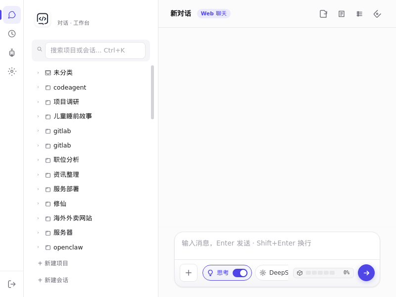
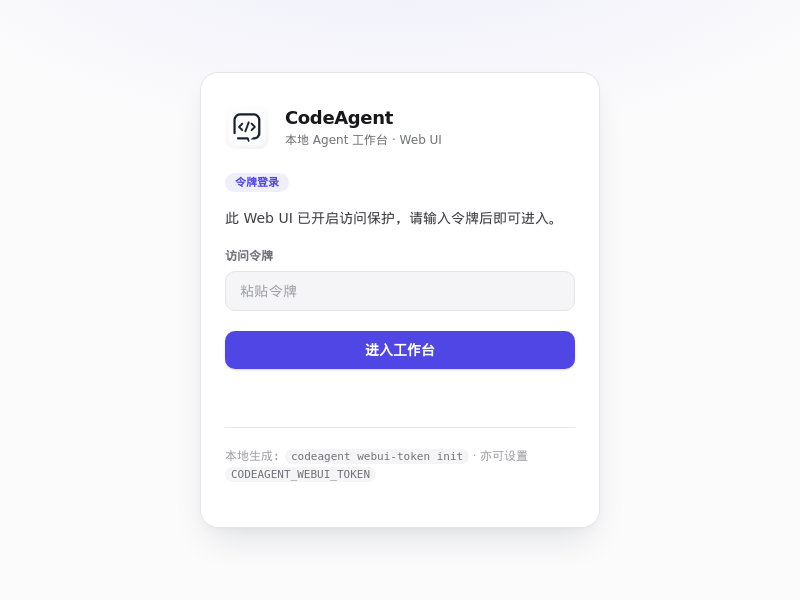

# CodeAgent

> **自主全栈开发 Agent** — 用 Markdown 配置人格与行为，开箱即用，DeepSeek 就绪。

[](https://pypi.org/project/tagword-codeagent/)
[](https://pypi.org/project/tagword-codeagent/)
[](https://github.com/tagword/codeagent/actions)
[](LICENSE)
[](pyproject.toml)

---

## 界面预览



内置 Web UI（单页应用，零构建）—— 项目/会话树、工具调用链、mermaid 图表、思考开关、模型切换，开箱即用。



## 为什么选 CodeAgent

| 痛点 | CodeAgent 的解法 |
|------|------------------|
| 🤖 通用助手只会聊天，不会干活 | **自主全栈 Agent**：独立承接「需求 → 开发 → 测试 → 部署」完整项目周期 |
| 📜 Agent 行为难定制、像黑盒 | **人格即配置**：用 Markdown（`agent.md` / `soul.md` / `skills.md`）定义身份、行为准则、技能，改配置即改人格 |
| 💸 商业工具按量收费、数据在云端 | **免费开源 + 自托管**：本地运行，数据不出门，无订阅 |
| 🇨🇳 国内网络环境装不上、用不顺 | **DeepSeek 就绪 + 国内友好**：内置 DeepSeek 适配，自动切换清华 PyPI 镜像 |

## 核心特性

- 🧠 **LLM 驱动** — 支持 DeepSeek、OpenAI、Anthropic、Ollama 本地模型及兼容 API，可切换
- 📜 **人格即配置** — 用 Markdown 定义 Agent 的身份、行为准则、技能，无需改代码
- 🛠️ **45+ 内置工具** — 文件操作、Shell 执行、代码分析、Git 管理、数据库、部署、搜索
- 🌐 **内置 Web UI** — 零构建单页应用：项目/会话树、工具调用链、mermaid 图表、健康面板、深色模式
- 💬 **CLI + 交互式聊天** — `codeagent chat --llm`、`codeagent run "任务"`，两种姿势随意切
- 📋 **项目管控** — 内置待办管理、项目规划（docs/plans 面板）、版本追踪
- 🔌 **可扩展** — 自定义工具、Webhook、多 Agent 协作（Multi-Agent Hub）
- 🧩 **多步工作流** — 内置 fix-and-commit、new-feature、audit-project 等自动化流水线
- ⏰ **定时任务** — 内置 cron 调度，Web UI 可视化配置，到点自动干活
- 🖥️ **跨平台** — Linux / macOS / Windows 桌面端（DMG / EXE）+ Docker 镜像
- 🌍 **国内友好** — 自动检测国内网络，使用 PyPI 镜像（清华源）加速安装

## 快速开始

### 📦 通过 PyPI 安装（推荐）

```bash
pip install tagword-codeagent
codeagent serve
```

浏览器打开 `http://localhost:8765` 即可使用。

> 💡 包名说明：`codeagent` 在 PyPI 上已被占用，本项目以 **`tagword-codeagent`** 发布。
> 核心引擎 `seed-kernel` / `seed-model-providers` / `seed-toolbox` 均为 PyPI 公开包，随 pip **自动安装**，无需额外操作。

### 🐳 通过 Docker 运行

```bash
docker pull ghcr.io/tagword/codeagent:latest

# 运行（挂载数据持久化）
docker run -d --name codeagent \
  -p 8765:8765 \
  -v ~/.codeagent:/root/.codeagent \
  ghcr.io/tagword/codeagent:latest
```

浏览器打开 `http://localhost:8765` 即可使用（更多见 [ARCHITECTURE.md](ARCHITECTURE.md)）。

### ⭐ 一键运行（GitHub 源码）

```bash
git clone https://github.com/tagword/codeagent.git
cd codeagent
bash run.sh
```

脚本会自动：
1. 检测 Python（≥ 3.9）和 Git
2. **自动识别国内网络** → 使用清华 PyPI 镜像加速
3. 创建虚拟环境 `.venv`
4. 安装 CodeAgent 及全部依赖（核心引擎 seed 框架，随 pip 自动拉取）
5. 启动 Web 服务 → 浏览器打开 `http://localhost:8765`

> 💡 支持自定义参数：`bash run.sh --port 8766 --host 0.0.0.0`
> 💡 `run.sh` 内置了网络重试和 tarball 降级机制，网络不稳定时比 `pip install -e .` 更可靠
> 💡 Windows 用户可使用 `install.ps1` / `run.ps1`

### 🔧 源码手动安装

```bash
git clone https://github.com/tagword/codeagent.git
cd codeagent

python -m venv .venv
source .venv/bin/activate  # Windows: .venv\Scripts\activate

# 依赖（seed-kernel 等）自动从 PyPI 拉取
pip install -e .

codeagent serve
```

## 命令行速查

```bash
codeagent --help                 # 查看帮助
codeagent serve                  # 启动 Web 服务（默认 8765 端口）
codeagent chat --llm             # 启动交互式聊天（LLM + 工具循环）
codeagent run "整理文件结构"      # 运行单次任务
codeagent webui-token init       # 生成 Web UI 访问令牌
codeagent webui-token show       # 查看当前令牌
codeagent config init            # 初始化配置文件
codeagent restart serve --port 8765  # 重启服务
```

## 配置

首次运行执行 `codeagent config init`，生成配置文件到 `config/` 目录。

核心环境变量（首次运行 `codeagent config init` 生成 `config/env`，含注释模板）：

| 配置项 | 说明 |
|--------|------|
| `CODEAGENT_PROVIDER` | LLM 提供商（deepseek / openai / anthropic / ollama 等） |
| `CODEAGENT_API_KEY` | API 密钥 |
| `CODEAGENT_MODEL` | 模型名称 |
| `CODEAGENT_BASE_URL` | API 端点地址 |
| `CODEAGENT_AGENT_ID` | 当前 Agent 标识（默认 `default`） |
| `CODEAGENT_WEBUI_TOKEN` | Web UI 访问令牌（也可用 `codeagent webui-token init` 生成） |

## 项目结构

```
codeagent/
├── codeagent/              # 核心源码
│   ├── cli/                # 命令行入口
│   ├── core/               # 核心模块（bootstrap / env / attachments 等）
│   ├── memory/             # 长期记忆与经验沉淀
│   ├── persona_defaults/   # 默认 Agent 人格（agent.md / soul.md / skills.md 等）
│   ├── runtime/            # 运行时管理
│   ├── server/             # HTTP / WebSocket 服务
│   ├── skills/             # 内置技能定义
│   ├── tools/              # 工具系统
│   └── web/                # Web 认证与内置 Web UI（单页应用，运行时内联）
├── packaging/              # 桌面端打包（macOS DMG / Windows EXE）
├── tests/                  # 测试
├── assets/                 # 图标与界面截图
├── run.sh / run.ps1        # 一键运行脚本
├── install.sh / install.ps1 # 一键安装脚本
├── Dockerfile              # 容器镜像（ghcr.io/tagword/codeagent）
├── pyproject.toml          # 项目元数据与依赖
└── README.md
```

## 技术栈

| 层 | 技术 |
|----|------|
| **核心引擎** | seed-kernel（LLM 调用 / 路由 / 会话 / 工具运行时） |
| **后端服务** | Python 3.9+ / Starlette / WebSocket / Uvicorn |
| **内置 Web UI** | 原生 JS 单页应用（运行时内联，零构建；mermaid / marked / DOMPurify） |
| **LLM 集成** | DeepSeek / OpenAI / Anthropic / Ollama / 兼容 API |
| **工具系统** | 异步工具调度 + 安全检查 + 沙箱 |
| **数据存储** | SQLite（会话 / 记忆 / 项目状态） |

## 与同类对比

| | **CodeAgent** | Cursor | Claude Code | Aider | OpenHands |
|---|---|---|---|---|---|
| 开源 & 自托管 | ✅ | ❌ | ❌ | ✅ | ✅ |
| 人格/行为可配置（Markdown） | ✅ | ❌ | 部分 | ❌ | ❌ |
| 内置 Web UI | ✅ | ✅ | ❌ | ❌ | ✅ |
| 多 LLM 后端（含 DeepSeek/Ollama） | ✅ | 部分 | 仅 Anthropic | ✅ | ✅ |
| 国内网络友好（镜像加速） | ✅ | ❌ | ❌ | ❌ | ❌ |
| 免费 | ✅ | ❌ | ❌ | ✅ | 部分 |

## 开发

```bash
# 安装开发依赖
pip install -e '.[dev]'

# 运行测试
pytest

# 代码检查
ruff check codeagent/

# 安全审计
bandit -r codeagent/
```

## 社区

- 🐛 提 Issue / 💡 提建议：<https://github.com/tagword/codeagent/issues>
- 🤝 贡献指南：[CONTRIBUTING.md](CONTRIBUTING.md)
- 📜 更新日志：[CHANGELOG.md](CHANGELOG.md)

## 许可证

[MIT](LICENSE) © 2025-2026 tagword
